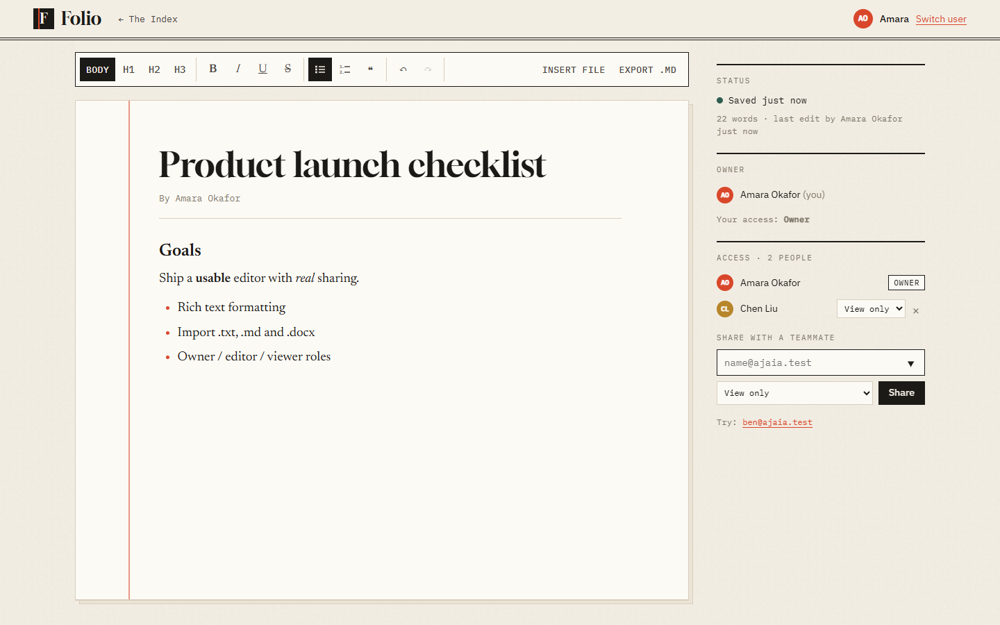

# Folio: shared drafts

A lightweight collaborative document editor built for the Ajaia AI-Native Full Stack take-home.
You can create, format, import, share and reopen documents, with owner/editor/viewer access enforced on the server.

**Live app:** https://folio-docs-q48q.onrender.com. On the free tier, the first load after an idle period can take about 30–50 seconds.
**Source:** https://github.com/SixxPathz/folio-docs
**Walkthrough video:** see [VIDEO_URL.txt](VIDEO_URL.txt)



## Test accounts

Auth is mocked on purpose: the sign-in page lists three seeded people, and one click signs you in as one of them. Use **Switch user** (top right) to change person.

| Person | Email | Seeded state |
|---|---|---|
| Amara Okafor | `amara@ajaia.test` | Owns *Q4 planning brief* (shared with Ben as **editor**); can **view** Ben's *Hiring loop notes* |
| Ben Mokoena | `ben@ajaia.test` | Owns *Hiring loop notes*; can **edit** *Q4 planning brief* |
| Chen Liu | `chen@ajaia.test` | Owns nothing and has nothing shared, so you can check that unshared docs stay invisible |

### 2-minute review script
1. Sign in as **Amara** and click **+ New draft**. The title is pre-selected, so type a name, press Enter, and write with the toolbar (H1–H3, bold, italic, underline, strikethrough, bulleted and numbered lists, quote). Changes autosave; watch *Status* in the right margin.
2. Refresh the page: the content and formatting are still there.
3. In the right margin, share the doc with `chen@ajaia.test` as **View only**.
4. Go back to **The Index**, then **Import a file** (or drag a file onto the page). Try the files in [`docs/sample-files/`](docs/sample-files).
5. **Switch user → Chen**. The doc is under *Shared with you*, marked "View only", and the editor is read-only.
6. **Switch user → Ben**, open *Q4 planning brief* in **two tabs**, and edit in both. The second save gets a version-conflict prompt instead of silently overwriting the first.

## Supported uploads
`.txt`, `.md` / `.markdown`, `.docx`, up to **2 MB**. Any other type is rejected with a clear message (HTTP 415).
- **Import a file** (Index page) creates a new document you own. If the file starts with a heading, that heading becomes the title.
- **Insert file** (editor toolbar) converts the file and inserts it at the cursor in the open draft.
- `.docx` conversion keeps headings, bold, italic, underline, lists and links. Images, tables, comments and tracked changes are dropped.

## Run locally

Requires Node 20+ (developed on Node 24).

```bash
npm install
npm run dev        # API on :3001 + Vite on :5173 (proxied) → open http://localhost:5173
```

Production-style (one process serves both the API and the built SPA):

```bash
npm run build
npm start          # http://localhost:3001
```

Other scripts:

```bash
npm test           # API test suite (Vitest + Supertest, in-memory DB)
npm run typecheck  # tsc --noEmit over client, server and tests
```

Data lives in `./data/folio.db` (SQLite via libSQL), created and seeded on first start. Delete the folder to reset.

## Deploy (free, no credit card)

The app is one Node service: Express serves both `/api` and the built React app.

1. **Database (Turso free tier).** Create a database at [turso.tech](https://turso.tech) and copy its URL (`libsql://…`) and an auth token.
   *(Optional: without it the app still runs, but on Render's free tier its SQLite file resets whenever the instance restarts.)*
2. **Push this folder to a GitHub repo.**
3. **Render** → *New* → *Blueprint* → pick the repo. [`render.yaml`](render.yaml) configures the build (`npm ci --include=dev && npm run build`), start command (`npm start`) and health check.
4. When prompted, set `DATABASE_URL` and `DATABASE_AUTH_TOKEN`. `SESSION_SECRET` is generated for you.

Note: Render's free instances sleep after about 15 minutes idle, so the first request after that takes about 30–50 seconds.

| Env var | Default | Purpose |
|---|---|---|
| `PORT` | `3001` | HTTP port |
| `DATABASE_URL` | `file:./data/folio.db` | libSQL URL: a local file, `libsql://…` (Turso) or `:memory:` |
| `DATABASE_AUTH_TOKEN` | – | Turso token |
| `SESSION_SECRET` | dev value | Signs the session cookie |

## Project layout

```
server/
  index.ts     boot: migrate, seed, serve API + built SPA
  app.ts       routes, access control, validation, error mapping
  content.ts   file → HTML conversion and the HTML sanitizer allowlist
  db.ts        libSQL client + schema
  seed.ts      demo users and documents
src/
  pages/       Login, Library ("The Index"), Editor
  components/  Toolbar, SharePanel, Masthead
  api.ts       typed fetch client
  styles.css   the whole design system (tokens at the top)
tests/
  api.test.ts  access control, conflicts, sanitizing, import (.md/.txt/.docx)
docs/
  screenshots/ sample-files/
```

More detail: [ARCHITECTURE.md](ARCHITECTURE.md) · [AI_WORKFLOW.md](AI_WORKFLOW.md) · [SUBMISSION.md](SUBMISSION.md)
